> Lauren Tan의 「All Code Is Slop (Except Mine)」 화면 해설과 실무 적용
{: .prompt-info }

**3줄 요약**

1. AI가 기존 코드의 패턴을 복제하므로, 반복되는 실수는 코드 구조·API·정적 검사로 막아야 한다.
2. 신뢰를 높이는 핵심은 생성량이 아니라 실행 화면·테스트·모델 검증처럼 다시 확인할 수 있는 증거다.
3. 품질을 지키는 내부 개발 과정을 먼저 안정시킨 다음, 그 과정을 자동화하고 여러 에이전트로 확장한다.

**영상 정보:** Lauren Tan / AI Engineer · 공개일 2026-11-14 · 길이 약 **17분 31초**. [영상](https://youtu.be/O_zcc6Xl12g) · [주최측 발표 페이지](https://ai.engineer/talks/O_zcc6Xl12g-all-code-is-slop-except-mine)

이 글에서 **‘발표 내용’은 영상과 직접 캡처한 화면에 근거한 요약**, **‘해설’은 작성자의 해석**, **‘추가 자료’는 영상에 없는 설명·예제**다. 수치는 발표자의 보고이며 독립적인 성능 감사 결과는 아니다. 회사명은 원영상 제목의 SpaceXSI 표기를 따랐다. 전체 발화의 재배포 허락은 확인되지 않아, 원문은 글 끝의 공식 전사 링크로 연결한다.

## 1. 00:20–02:03 — 생산량보다 중요한 질문

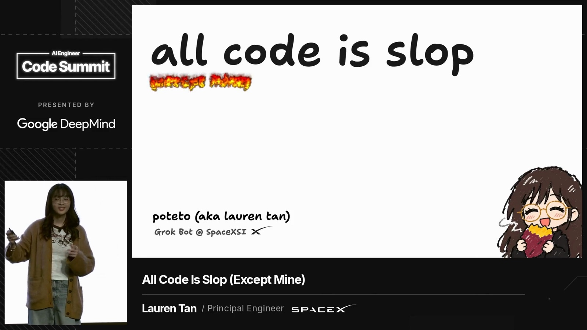

*화면 1 · [00:32](https://www.youtube.com/watch?v=O_zcc6Xl12g&t=32s): 제목부터 자신의 코드만 예외라고 생각하는 개발자의 태도를 풍자한다.*

발표 내용: Lauren은 직전 달 자신이 수천 건의 PR을 보냈다는 경험에서 출발한다. 하지만 강연의 질문은 ‘어떻게 코드를 더 많이 만들까’보다 ‘산출물이 급증해도 품질을 유지할 수 있는가’에 가깝다.

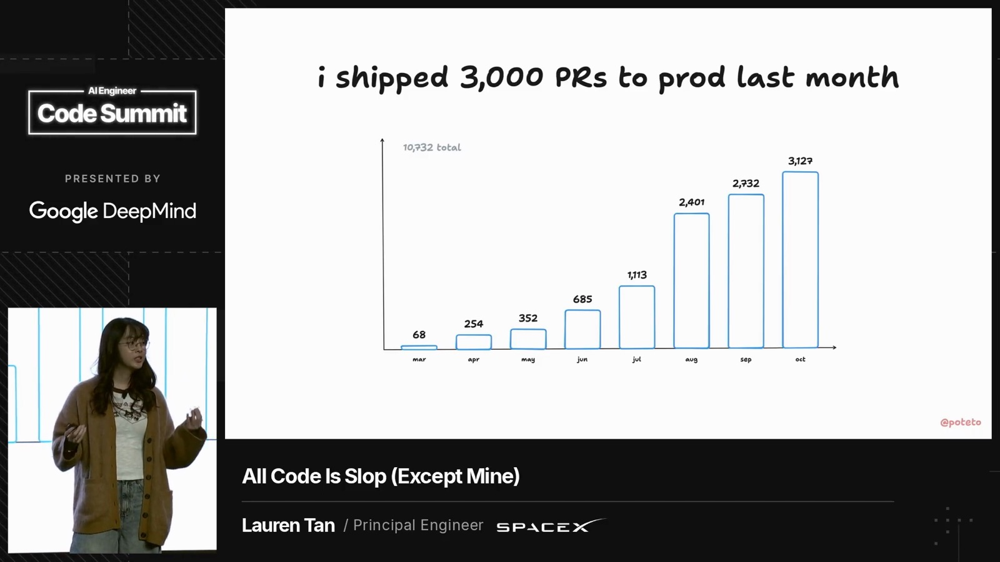

*화면 2 · [00:49](https://www.youtube.com/watch?v=O_zcc6Xl12g&t=49s): 개인 월별 수치와 누적 수치가 구분된다. 10월은 3,127건, 누적은 10,732건으로 보인다. 뒤에 나오는 팀 전체 수치와 혼동하면 안 된다.*

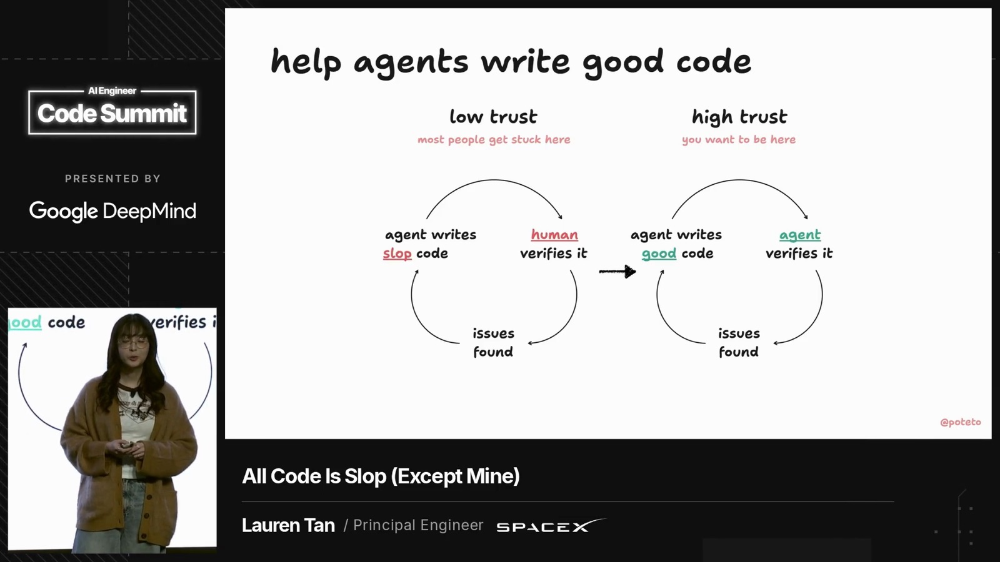

*화면 3 · [01:53](https://www.youtube.com/watch?v=O_zcc6Xl12g&t=113s): 왼쪽은 사람이 결과를 검증하는 과정, 오른쪽은 에이전트가 자기 작업을 검증하는 과정이다.*

**해설:** 사람이 모든 변경을 같은 깊이로 검토하는 동안 생산량만 늘리면 병목은 사라지지 않는다. 생성 단계의 비용을 낮춘 만큼, 검증 단계의 처리량도 키워야 한다. 이 그림에서 ‘높은 신뢰’는 무조건 승인하는 태도가 아니라, 결과를 검사할 수 있는 환경에 투자한 상태를 뜻한다.

## 2. 02:03–03:25 — 신뢰를 만드는 층의 순서

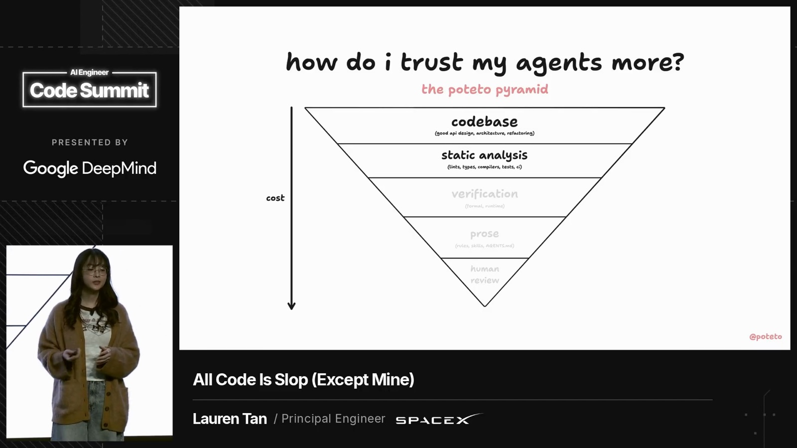

*화면 4 · [02:23](https://www.youtube.com/watch?v=O_zcc6Xl12g&t=143s): 코드베이스와 정적 분석이 넓은 층을 차지하고, 그 아래에 검증·문장형 지침·사람의 검토가 놓인다.*

발표 내용: API와 아키텍처를 개선하고, 타입·컴파일러·lint·검사를 활용해 잘못된 선택을 어렵게 만든다. 실행 검증과 형식 검증을 보태고, 마지막에 판단이 필요한 일을 규칙·스킬·문서로 설명한다.

**해설:** 모든 문제를 같은 종류의 도구로 풀려고 하면 지침이 길어진다. 먼저 문제의 성격을 나누는 편이 좋다.

| 반복되는 문제 | 먼저 검토할 장치 | 그 장치의 한계 |
| --- | --- | --- |
| 금지된 모듈을 import함 | 의존성 경계 검사 | 동적 로딩·별칭도 별도 고려해야 함 |
| 허용되지 않는 상태를 만듦 | 타입·상태 전이 모델 | 실제 네트워크·저장소 동작까지 보장하지 않음 |
| 동작을 확인하지 않고 완료함 | 실행·테스트 증거 | 잘못된 기대값도 통과시킬 수 있음 |
| 우선순위·예외를 판단해야 함 | 짧은 문서와 사람의 판단 | 자동 강제 장치가 아님 |

이 표는 **추가 해설**이다. 발표의 역피라미드를 운영 의사결정으로 옮긴 것이며, 발표자가 제시한 체크리스트를 복제한 것은 아니다.

## 3. 03:02–04:50 — 코드베이스는 다음 작업의 입력이다

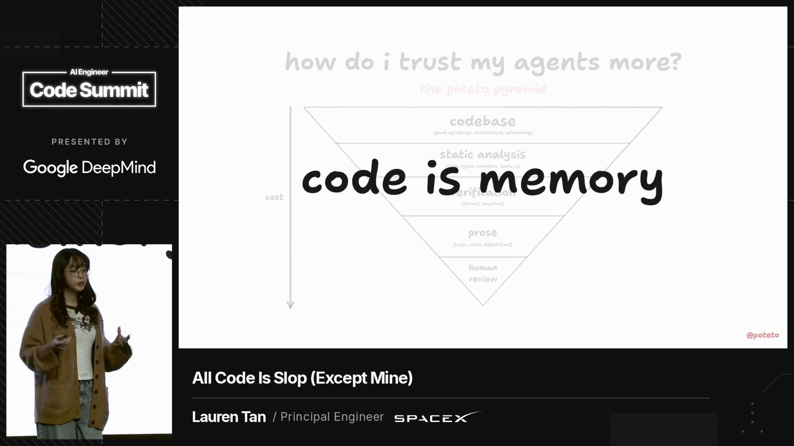

*화면 5 · [03:02](https://www.youtube.com/watch?v=O_zcc6Xl12g&t=182s): 에이전트가 읽는 가장 큰 맥락 중 하나가 기존 코드라는 주장이다.*

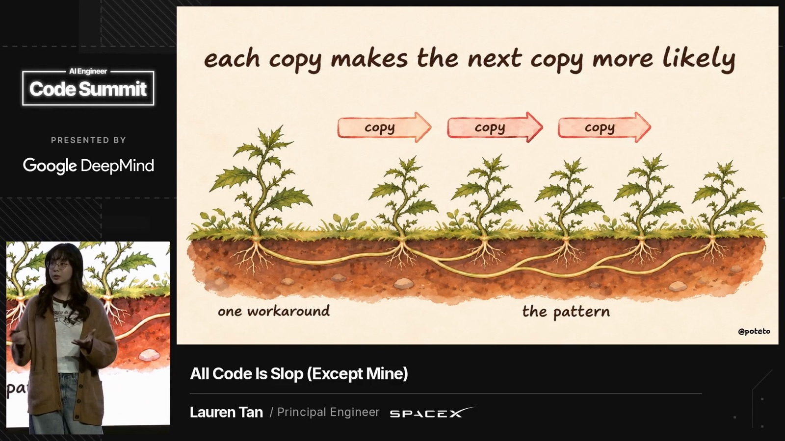

*화면 6 · [04:28](https://www.youtube.com/watch?v=O_zcc6Xl12g&t=268s): 한 번의 우회 구현이 여러 번 복제되어 표준 패턴처럼 굳어지는 모습을 식물의 확산에 비유한다.*

**해설:** 임시방편이 저장소에 남아 있으면 다음 에이전트는 그것을 팀의 관례로 읽을 수 있다. ‘이번 한 번만’ 넣은 코드가 다음 작업의 예제가 되는 셈이다. 따라서 새 실수를 막는 규칙만 추가해서는 부족하다. 이미 남은 나쁜 예제도 함께 정리해야 한다.

실무에서는 실수 한 건을 발견할 때 세 가지를 묻는 방식으로 적용할 수 있다. 입력으로 읽힌 기존 예제가 무엇인지, 같은 실수를 기계적으로 찾을 수 있는지, 더 나아가 잘못 사용할 API 자체를 줄일 수 있는지다. 이는 사람을 코드 한 줄씩 승인하는 역할에서, 좋은 코드가 자라기 쉬운 구조를 만드는 역할로 이동시킨다.

## 4. 04:58–06:01 — 세심함이 필요한 API를 좁힌다

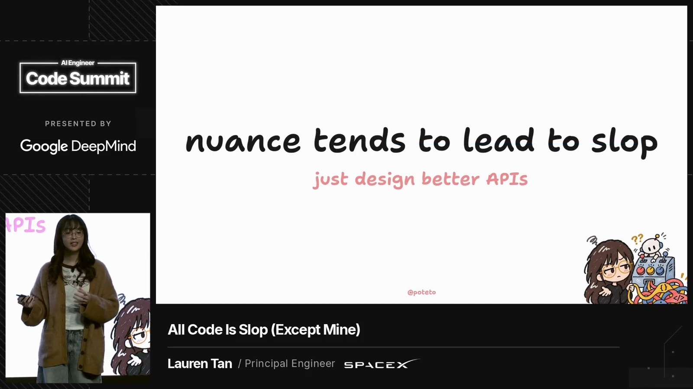

*화면 7 · [05:28](https://www.youtube.com/watch?v=O_zcc6Xl12g&t=328s): 좋은 사용에 미묘한 판단이 많이 필요한 API가 반복적인 품질 문제를 만든다는 설명이다.*

발표 내용: 팀의 Electron 클라이언트 프레임워크 Dune은 제품 코드의 `useEffect` 사용을 제한하고, 일부 프레임워크 API 내부에서만 허용하는 전략을 취한다.

**해설:** 이것은 React가 `useEffect`를 폐기했다는 뜻이 아니다. 제품 팀이 허용 범위를 좁힌 사례다. 외부 시스템과의 동기화에는 여전히 Effect가 필요할 수 있다. 핵심은 ‘이 API를 조심해서 써라’를 모든 작성자에게 반복하는 대신, 검토된 통로를 제공하는 것이다.

### 추가 자료 — 파생 상태는 계산으로 없앨 수 있다

아래 코드는 강연에 나온 코드가 아니라, 불필요한 Effect를 제거한다는 생각을 설명하기 위해 새로 만든 예제다.

```jsx
// 별도 상태와 Effect를 유지하지 않고, 현재 입력에서 바로 계산한다.
export function SelectedCount({ items, selectedIds }) {
  const count = items.filter(item => selectedIds.has(item.id)).length;
  return <output>{count}개 선택</output>;
}
```

이렇게 하면 입력과 계산 결과라는 두 상태를 따로 동기화할 필요가 없다. 다만 비용이 큰 계산의 최적화는 별도 판단이다. [React 공식 설명](https://react.dev/learn/you-might-not-need-an-effect)

## 5. 06:02–06:55 — 폴더 이름을 강제 가능한 경계로 만든다

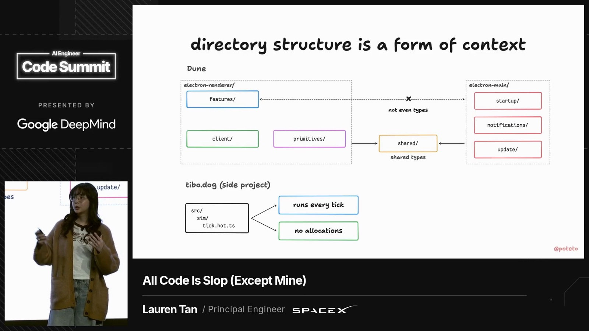

*화면 8 · [06:33](https://www.youtube.com/watch?v=O_zcc6Xl12g&t=393s): main과 renderer를 명시적으로 분리하고, 허용하지 않은 import를 검사하는 구조다.*

**해설:** 폴더 구조는 의도를 전달하지만 그 자체로 위반을 막지는 않는다. 이름으로 설명하고 검사기로 강제해야 효과가 있다. 또한 Electron의 main과 renderer는 서로 다른 **프로세스 역할**이다. 발표에서 thread라는 표현이 나오더라도, 실제 구조를 학습할 때는 프로세스 모델과 IPC 경계로 이해하는 편이 정확하다. [Electron 공식 프로세스 모델](https://www.electronjs.org/docs/latest/tutorial/process-model)

### 추가 자료 — lint로 허용 범위를 줄이는 최소 예시

```js
// eslint.config.mjs — 설명용 정책 예시
export default [{
  files: ['src/product/**/*.js'],
  rules: {
    'no-restricted-imports': ['error', {
      paths: [{
        name: 'react',
        importNames: ['useEffect'],
        message: '제품 계층에서는 검토된 동기화 API를 사용하세요.'
      }],
      patterns: [{
        group: ['@main/*'],
        message: '제품 UI에서 main 계층을 직접 import할 수 없습니다.'
      }]
    }]
  }
}];
```

이 예시는 named import와 지정한 별칭을 막는 좁은 규칙이다. namespace import, 다른 상대 경로, 동적 import까지 모두 막는 완성된 경계 검사는 아니다. 실제 적용 시에는 저장소의 경로 해석에 맞춘 의존성 분석을 함께 둬야 한다. 전체 예제는 [examples/eslint.config.mjs](/assets/files/O_zcc6Xl12g/eslint.config.mjs)에 있다. [ESLint 규칙 문서](https://eslint.org/docs/latest/rules/no-restricted-imports)

## 6. 06:56–09:38 — 우회 구현을 설명하는 주석보다 원인 제거

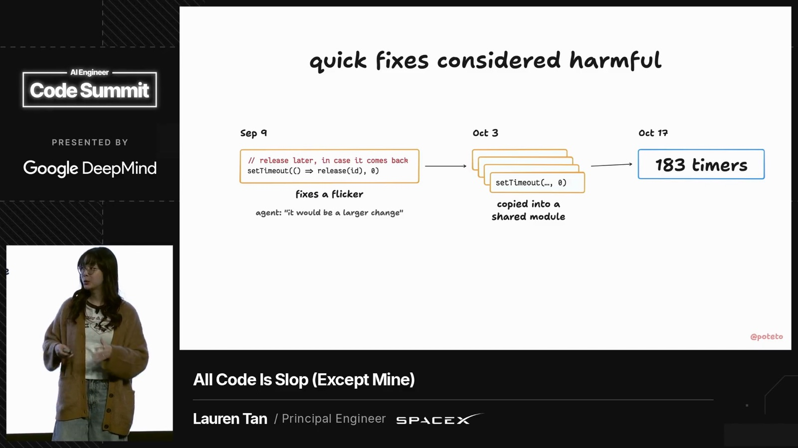

*화면 9 · [07:33](https://www.youtube.com/watch?v=O_zcc6Xl12g&t=453s): 임시 타이머가 공유 코드로 복제되며 늘어나는 사례를 보여 준다.*

발표 내용: 명령형 코드와 React의 선언형 코드가 충돌하는 지점을 타이머로 봉합했고, 그 정당성을 적은 주석이 또 다른 에이전트의 복제를 부추겼다고 설명한다.

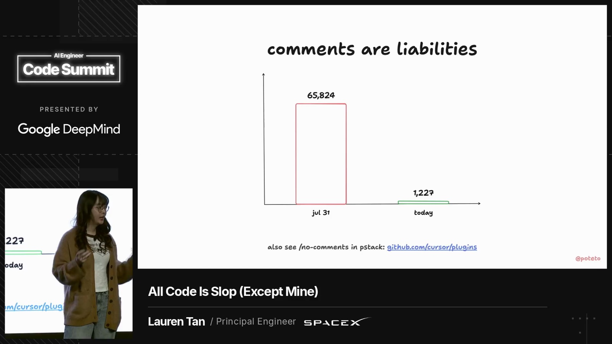

*화면 10 · [08:24](https://www.youtube.com/watch?v=O_zcc6Xl12g&t=504s): 주석을 크게 줄인 두 코드베이스의 비교다. 코드베이스 크기까지 통제한 실험으로 제시되지는 않는다.*

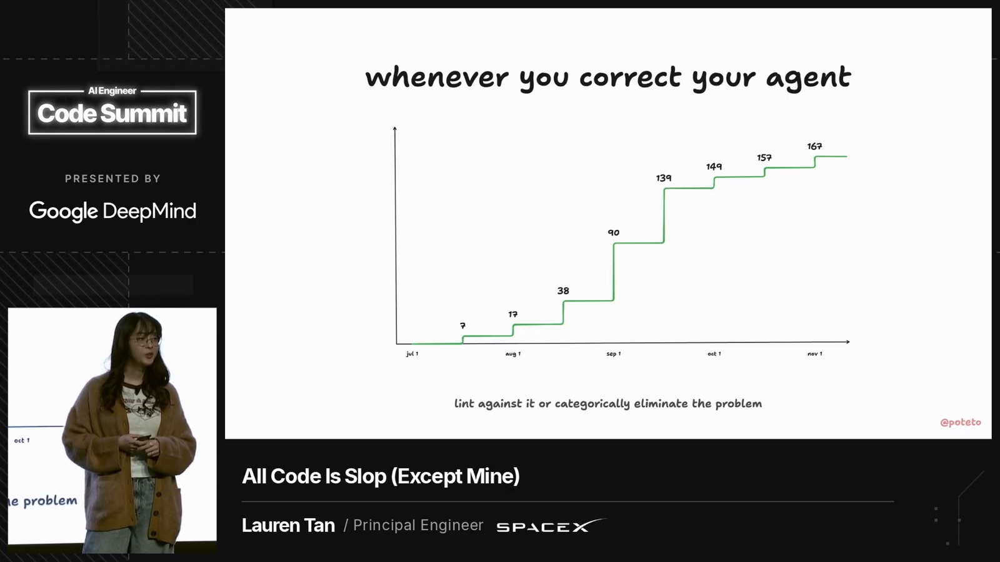

*화면 11 · [09:34](https://www.youtube.com/watch?v=O_zcc6Xl12g&t=574s): 반복해서 사람에게 검토를 맡기는 대신, 교정 경험을 검사와 구조 개선으로 축적한다.*

**해설:** 이 사례에서 일반화할 부분은 ‘모든 주석 삭제’가 아니다. 설계상의 빈틈을 장문의 해명으로 덮으면 후속 작성자가 그 해명을 허가증으로 읽을 수 있다는 점이다. 외부 제약·보안상 이유·공개 API 계약처럼 코드만으로 드러나지 않는 설명은 여전히 유용하다.

타이머도 동일하다. 타이머 사용 자체가 언제나 오류인 것은 아니다. 필요한 스케줄링인지, 다른 코드가 준비되기를 막연히 기다리는 우회 구현인지 구분해야 한다. 후자라면 상태·이벤트·수명주기 경계를 먼저 고치는 편이 낫다.

## 7. 09:40–10:49 — 실행 가능한 검증 환경을 준다

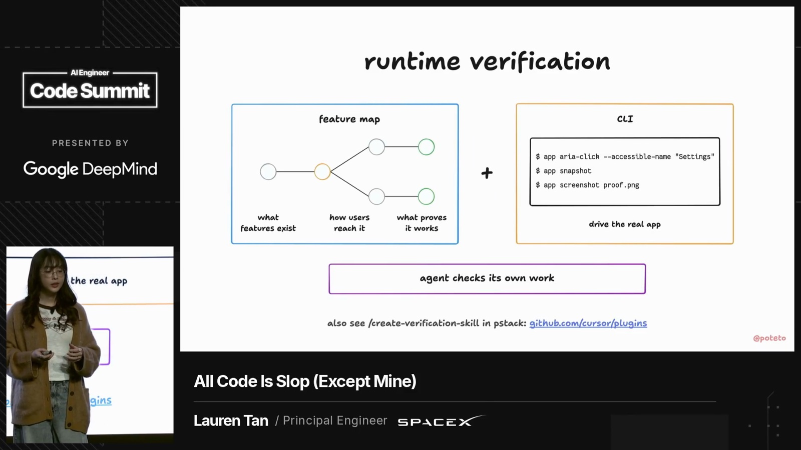

*화면 12 · [10:41](https://www.youtube.com/watch?v=O_zcc6Xl12g&t=641s): 기능 지도와 재사용 가능한 CLI를 묶어 에이전트가 실제 앱을 조작하게 한다.*

**해설:** 검증에는 무엇을 할 수 있는지, 사용자가 어떤 경로로 이동하는지, 성공을 무엇으로 판단할지가 필요하다. 기능 지도는 UI의 공통 언어를 만들고, CLI는 조작 절차를 재사용하게 만든다. 화면 한 장만 받기보다 실행한 변경본·행동·기대 결과를 함께 받아야 증거로 쓸 수 있다.

### 추가 자료 — 기다릴 시간을 찍지 말고 기대 상태를 확인한다

```js
// Playwright 설명 예시: 실제 앱의 경로·레이블에 맞춰 바꿔야 한다.
await page.goto('http://localhost:3000/settings');
await page.getByRole('textbox', { name: '표시 이름' }).fill('성겸');
await page.getByRole('button', { name: '저장', exact: true }).click();
await expect(page.getByRole('status')).toHaveText('저장되었습니다');
await page.reload();
await expect(page.getByRole('textbox', { name: '표시 이름' }))
  .toHaveValue('성겸');
```

새로고침 뒤에도 값이 남는지를 확인해야, 단순히 성공 알림만 띄운 구현을 걸러낼 수 있다. 자동 재시도 assertion은 임의의 고정 대기보다 기대 상태를 직접 표현한다. 이 코드는 예시 앱이 없어 실행한 통합 테스트는 아니다. [Playwright assertion 공식 문서](https://playwright.dev/docs/test-assertions)

## 8. 10:50–11:50 — 형식 검증과 속성 기반 테스트의 다른 질문

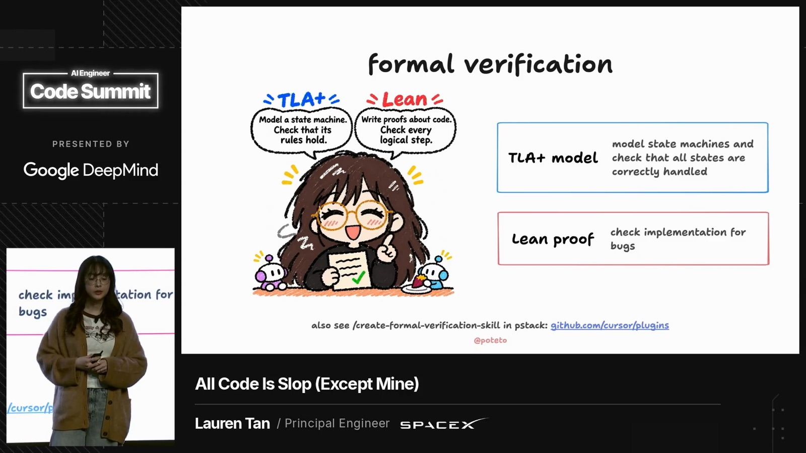

*화면 13 · [11:05](https://www.youtube.com/watch?v=O_zcc6Xl12g&t=665s): 모델의 상태·동작을 검토하는 접근과 알고리즘 명제를 증명하는 접근을 구분한다.*

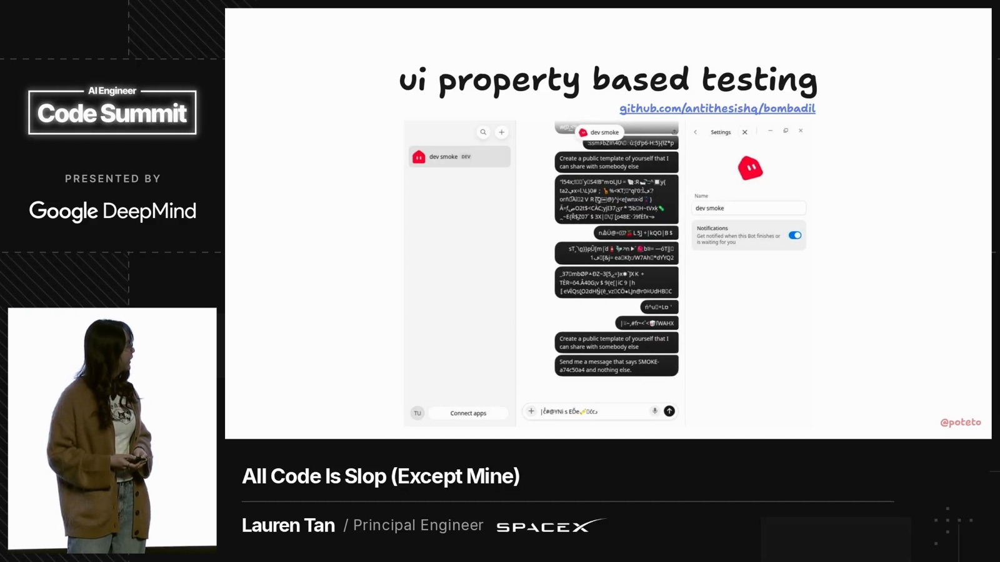

*화면 14 · [11:37](https://www.youtube.com/watch?v=O_zcc6Xl12g&t=697s): Bombadil을 이용한 UI 탐색 데모의 한 프레임이다. 정지 화면만으로 전체 실행의 성공 여부를 검증할 수는 없다.*

발표 내용: 팀은 다중 장치 알림 흐름에 TLA+를, 일부 가상화 알고리즘에 Lean을 사용한다고 설명한다. UI에는 Bombadil도 실험 중이다.

**추가 자료 — 용어를 섞지 않고 읽기**

| 방법 | 주로 묻는 질문 | 여기서 보장하지 않는 것 |
| --- | --- | --- |
| 실행 테스트 | 이 구현을 이 조건으로 실행하면 기대대로 되는가? | 모든 입력·모든 실행 순서의 정답 |
| 속성 기반 테스트 | 여러 입력·행동을 생성해도 정한 속성이 유지되는가? | 탐색하지 않은 모든 경우에 대한 증명 |
| TLA+ 모델 검사 | 명시한 상태 모델과 탐색 범위에서 잘못된 경로가 있는가? | 모델과 실제 제품이 완전히 일치한다는 보장 |
| Lean 증명 | 정의한 전제에서 수학적 명제가 성립하는가? | 명세 밖 성능·시각 품질·운영 전체의 무결점 |

예를 들어 가상화 인덱스 범위가 맞다는 명제를 증명해도, 실제 앱의 모든 깜빡임 원인이 제거됐다고 바로 결론낼 수는 없다. 모델·정리·제품 사이의 연결도 검증 대상이다. [TLA+ 창시자의 설명](https://lamport.azurewebsites.net/tla/tla.html) · [Lean 공식 학습 자료](https://lean-lang.org/learn/) · [Bombadil 공식 저장소](https://github.com/antithesishq/bombadil)

### 추가 자료 — 외부 부작용을 실행하지 않는 상태 모델

[examples/invariants.mjs](/assets/files/O_zcc6Xl12g/invariants.mjs)는 ‘준비된 초안의 승인된 본문만 발송 단계에 들어갈 수 있다’는 상태 규칙을 검사한다. 실제 메시지를 보내거나 외부 서비스에 접속하지 않는다.

```js
if (event.type === 'send') {
  if (state.kind !== 'approved') return state;
  if (event.body !== state.body) return state;
  return { kind: 'sent', body: state.body };
}
```

중요한 것은 if문 개수가 아니라 **규칙을 명세하고 위반 경로를 찾을 수 있게 만드는 것**이다. 예제는 유한한 이벤트 집합의 짧은 순서를 탐색한다. 실제 사용자 인증·수신자 검증·중복 발송 방지까지 구현한 제품이나 형식 증명은 아니다.

## 9. 11:51–13:19 — 생성보다 확인에 예산을 쓴다

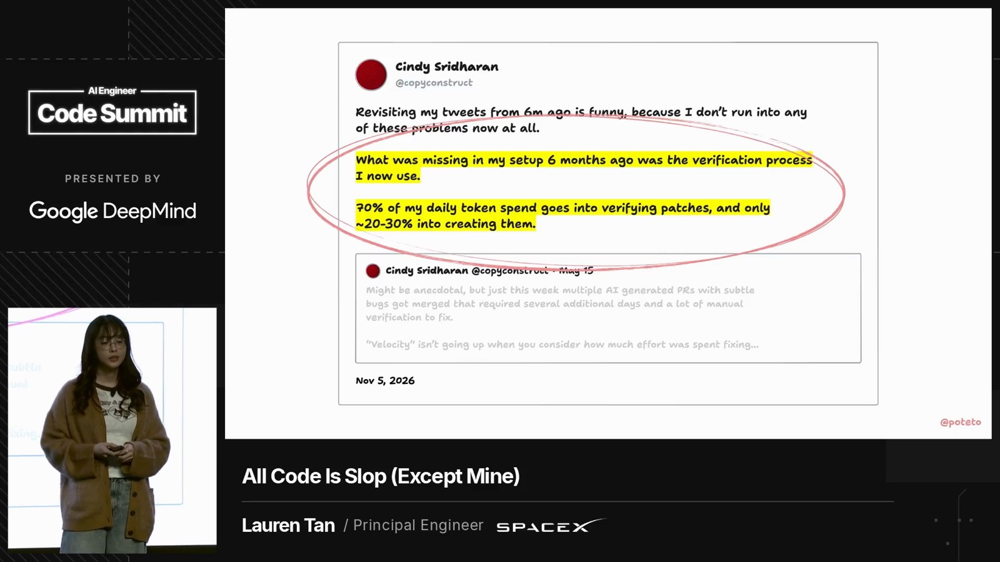

*화면 15 · [12:11](https://www.youtube.com/watch?v=O_zcc6Xl12g&t=731s): 검증에 일일 토큰의 약 70%를 쓴다는 다른 개발자의 경험이 소개된다.*

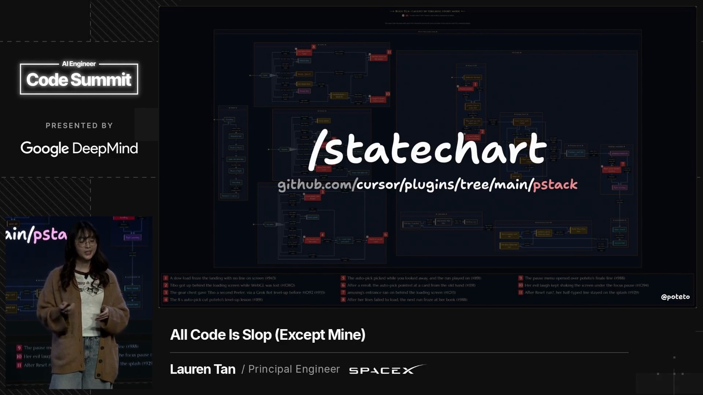

*화면 16 · [13:07](https://www.youtube.com/watch?v=O_zcc6Xl12g&t=787s): 사용자가 경험하는 상태와 전이를 그림으로 검토하는 도구를 보여 준다.*

**해설:** 70%는 업계 표준 예산 배분이나 최적화된 정답이 아니다. 발표가 강조하는 방향은 ‘더 싼 생성’이 아니라 ‘더 싸진 검증’을 적극적으로 활용하라는 것이다. 위험이 낮은 문구 수정과 데이터 손실 가능성이 있는 상태 변경에는 서로 다른 검증 비용을 배분해야 한다.

상태도도 그 자체로 증명은 아니다. 화면이 예뻐 보이는 것과 전이가 올바른 것은 다르다. 상태도에서 승인 취소, 실패 후 재시도, 오래된 응답, 권한 변경 같은 경로를 검토하고, 필요한 성질을 테스트나 모델 검사로 연결해야 한다. [발표자의 pstack 저장소](https://github.com/cursor/plugins/tree/main/pstack)

## 10. 13:32–15:10 — 생산성 수치를 읽을 때 구분할 것

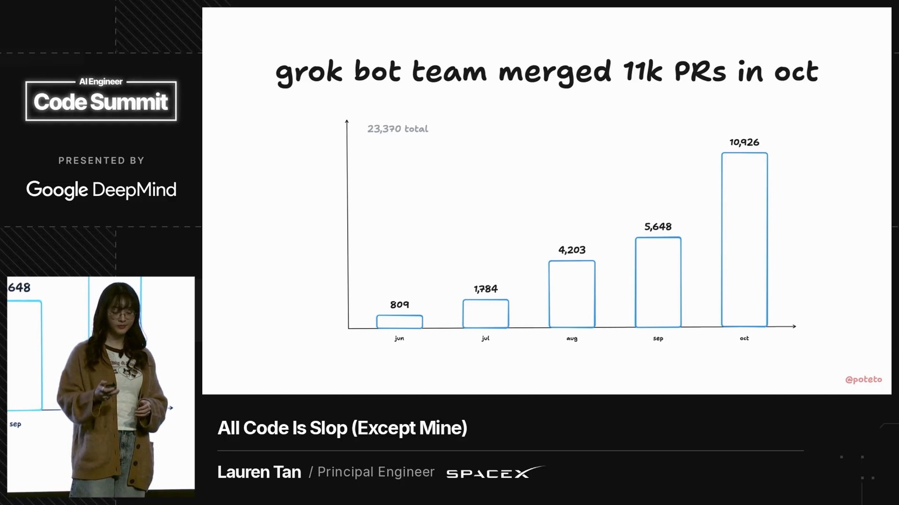

*화면 17 · [13:43](https://www.youtube.com/watch?v=O_zcc6Xl12g&t=823s): 10월 팀 PR은 10,926건으로 표시된다. 발표의 약 11,000건은 이 수치를 반올림한 설명이다.*

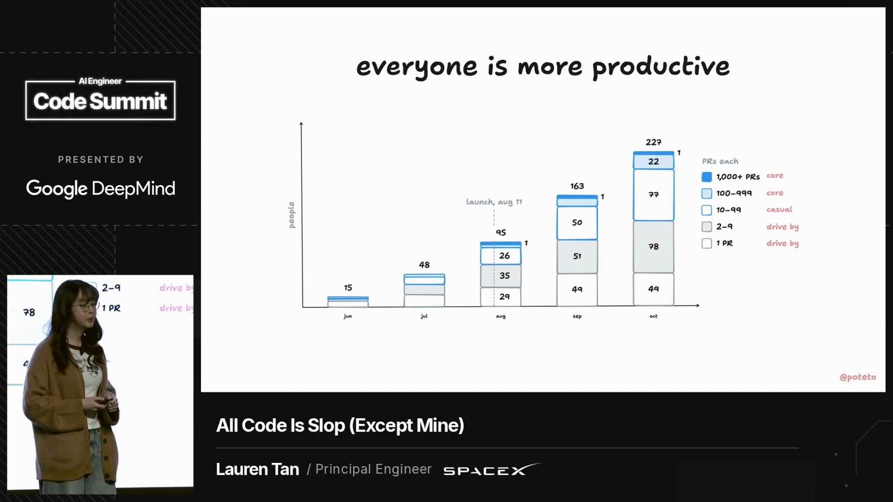

*화면 18 · [14:10](https://www.youtube.com/watch?v=O_zcc6Xl12g&t=850s): 기여자 수와 각 구간의 기여량을 함께 본다. 발표에서는 10월 기여자가 약 227명이라고 설명한다.*

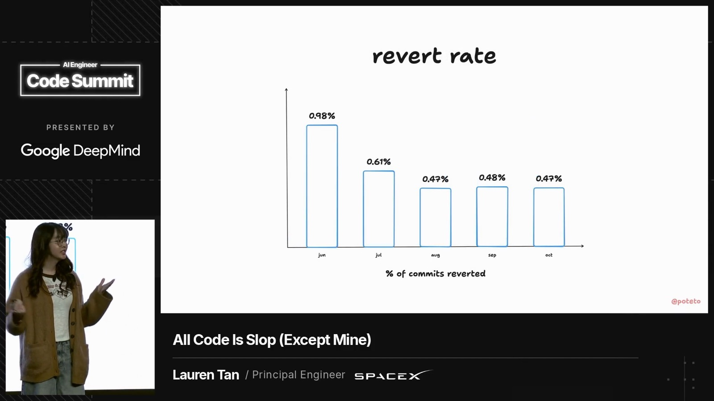

*화면 19 · [14:18](https://www.youtube.com/watch?v=O_zcc6Xl12g&t=858s): 축 설명은 되돌린 커밋의 비율이다. 10월 표시는 0.47%이며 발표에서는 약 0.5%로 설명한다.*

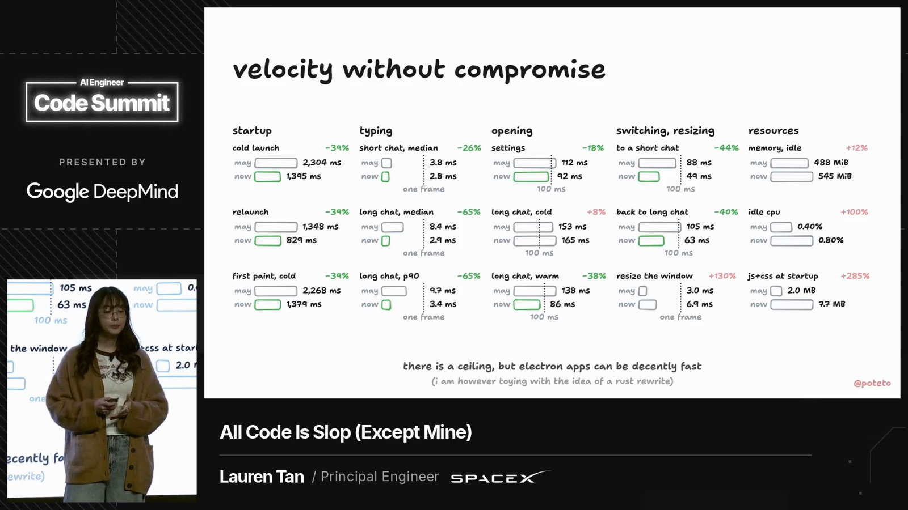

*화면 20 · [14:46](https://www.youtube.com/watch?v=O_zcc6Xl12g&t=886s): 시작·입력·채팅 동작 등의 전후 성능을 여러 측정값으로 비교한다.*

**해설:** 이 네 장을 함께 읽어야 ‘변경이 많아졌는데 품질은 어땠나’를 질문할 수 있다. 다만 다음 네 가지를 구분해야 한다.

1. 개인 월별 PR과 팀 전체 PR은 다른 지표다.
2. 발표자는 PR의 되돌림을 말하지만 슬라이드의 분모 설명은 커밋이다. 정확한 집계 정의는 추가 확인이 필요하다.
3. 되돌림이 없었다고 버그가 없었다는 뜻은 아니다. 문제를 후속 커밋으로 고쳤을 수도 있다.
4. PR 수가 늘어난 것이 사업 성과·사용자 만족 개선과 동일하다는 근거는 제시되지 않는다. 성능 비교도 측정 환경·표본·기간을 통제한 독립 실험으로 보기는 어렵다.

따라서 숫자를 내 팀의 목표로 복사하기보다, 변경 실패·사용자 영향·복구 시간·성능 회귀를 함께 측정하는 계기로 삼는 편이 좋다. 이 문단은 **추가 분석**이며 강연의 성과를 부정하거나 검증 완료로 인정한 것은 아니다.

## 11. 15:11–17:10 — 안정된 개발 과정을 만든 다음 자동화한다

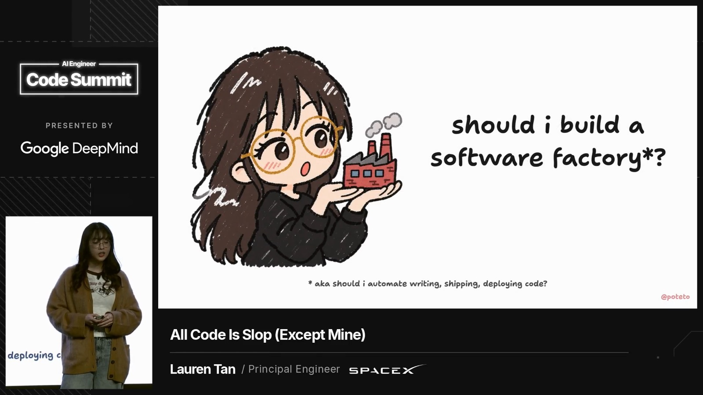

*화면 21 · [15:33](https://www.youtube.com/watch?v=O_zcc6Xl12g&t=933s): 대규모 자동화 이전에 기반이 준비되었는지를 묻는다.*

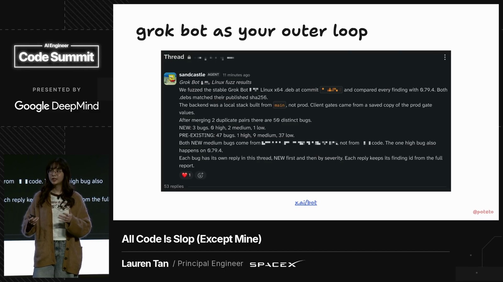

*화면 22 · [16:34](https://www.youtube.com/watch?v=O_zcc6Xl12g&t=994s): 새 릴리스 이후 탐색·버그 발견·수정 PR을 잇는 자동화 사례다.*

**해설:** 내부 과정은 한 변경을 이해하고 작성하고 확인하는 과정이다. 바깥 과정은 어떤 작업을 언제 시작할지, 여러 작업을 어떻게 연결할지를 결정한다. 내부 과정이 불안정한 상태에서 바깥 자동화만 강화하면 같은 문제를 더 빠르고 넓게 재생산할 수 있다.

발표 팀의 자동 병합 경험을 그대로 일반 정책으로 옮겨서는 안 된다. 제품의 실패 비용과 검사 범위가 다르기 때문이다. 예를 들어 개인정보 처리·결제·권한 부여는 일반 UI 정리와 다른 통제가 필요하다. 발표의 구조적 교훈은 자동 승인 자체보다 **자동화 전에 실패 경로를 줄이는 순서**에 있다.

## 12. 추가 자료 — 내 작업에 적용하는 작은 출발점

한 번에 모든 도구를 도입할 필요는 없다. 최근 반복된 실수 하나를 골라 ‘사람의 기억 없이 다음 발생을 막을 수 있는가’를 실험할 수 있다.

1. 실패 한 건을 재현 가능한 입력과 기대 결과로 적는다.
2. 금지 패턴·상태 규칙·실행 테스트 중 무엇으로 가장 직접적으로 막을지 정한다.
3. 기존 위반을 정리하고 검사 실패 메시지에 수정 방향을 넣는다.
4. 다음 변경에서 검사 결과와 사용자 관점의 실행 증거를 함께 확인한다.
5. 사람이 놓치기 쉬운 경로가 남는지 본 뒤 자동화 범위를 넓힌다.

이것은 이 글에서 제안하는 적용 순서다. 실제 서비스를 대상으로 도구 설치·설정 변경·자동 병합을 수행했다는 뜻은 아니다.

### 용어 빠르게 찾기

| 용어 | 이 글에서의 뜻 |
| --- | --- |
| PR | 변경을 제안하고 검토·병합하는 단위. 작업 크기는 팀마다 다름 |
| lint | 소스의 특정 패턴·규칙 위반을 자동 검사하는 장치 |
| 불변식 | 허용된 동작이 이어지는 동안 유지되어야 하는 성질 |
| feature map | 기능·사용 경로·확인할 증거를 공유하는 지도 |
| runtime verification | 여기서는 실제 앱 실행과 관찰을 포함하는 넓은 의미로 사용 |
| model checking | 명시한 모델에서 상태·실행 경로를 탐색해 성질을 검사하는 방법 |
| property-based testing | 입력·행동을 생성해 일반 성질을 검사하는 방법 |
| revert rate | 변경을 되돌린 비율. 버그율·사용자 영향과 같지 않음 |

## 핵심 정리

이 강연에서 가져올 가장 실용적인 변화는 **에이전트를 한 번 교정할 때마다 다음 작업의 환경도 개선하는 습관**이다. 코드가 좋은 예제가 되게 만들고, 반복 실수를 검사로 옮기고, 실행 결과를 증거로 남긴다. 그 뒤에 자동화를 더한다.

그러면 신뢰는 ‘잘하겠지’라는 기대 대신, 무엇을 검사했고 어떤 실패를 아직 막지 못하는지 설명할 수 있는 상태가 된다.

## 출처와 읽는 방법

- 원영상: [AI Engineer / Lauren Tan](https://www.youtube.com/watch?v=O_zcc6Xl12g), 17:31, 2026-11-14 공개.
- 원문 전사: [주최측 타임스탬프 JSON](https://ai.engineer/api/data/transcript?slug=youtube-87dd31e7fa6155e8455b&format=json). 자동 전사에는 제품명·기술명 인식 오류가 있어 Grok Bot, Dune, TLA+, Lean, pstack 등은 화면과 대조했다.
- 모든 본문 이미지는 같은 영상의 1920×1080 프레임을 직접 캡처한 PNG다. 인물·로고·슬라이드는 원저작자의 자료다.
- 코드 예시는 모두 **추가 자료**다. 원강연의 내부 코드나 Dune 구현을 복원한 것이 아니다.
