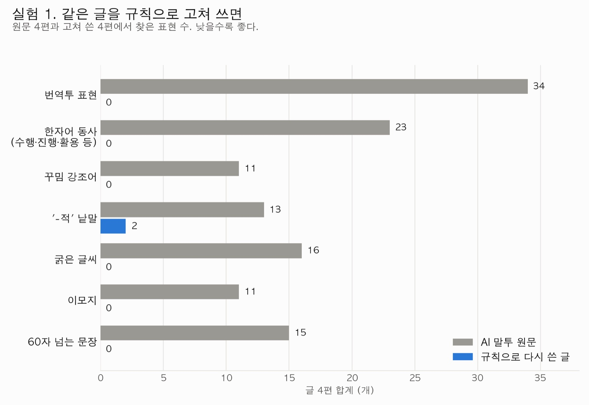
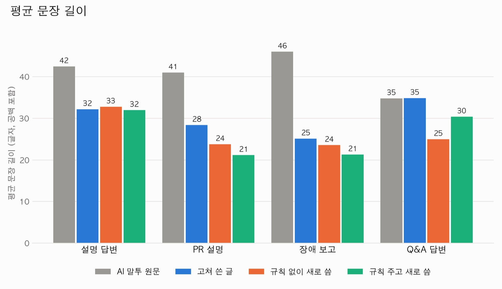

요즘 AI와 대화하는 시간이 길다. 답은 대체로 맞다. 그런데 어떤 답은 끝까지 읽기가 힘들다. 문장은 매끈한데 머리에 남는 게 없다. 나는 이런 글을 "쇠냄새 나는 글"이라고 부른다. 사람이 쓴 글에서는 잘 안 나는, 기계를 거친 냄새다.

이 글은 그 냄새를 줄이는 방법을 찾은 기록이다. 영어권에서 나온 [SimpleEnglish](https://github.com/AminBlg/SimpleEnglish)를 읽고, 한국어 규칙으로 옮기고, 실제로 글을 고쳐 재 봤다. 실험은 Claude에게 맡겼고, 측정 스크립트와 원자료는 글 끝에 붙였다.

## 쇠냄새는 어디서 나나

읽기 힘든 AI 한국어를 뜯어 보면 같은 버릇이 되풀이된다. 아래는 실험용 원문에서 뽑은 문장이다.

> 커넥션 풀은 단순히 연결을 재사용하는 기술이 아니라, 애플리케이션의 성능과 안정성을 동시에 보장하는 **체계적인 리소스 관리 전략**입니다.

한 문장에 버릇이 넷 들어 있다. "단순히 A가 아니라 B"는 영어 "not just X, it is Y"를 그대로 옮긴 틀이다. "체계적인", "전략"은 사실이 아니라 평가다. 굵은 글씨는 강조할 이유 없이 붙었다. "성능과 안정성을 동시에 보장"은 무엇을 얼마나 보장하는지 말하지 않는다.

내가 자주 걸리는 버릇을 묶으면 여섯 가지다.

1. 번역투. "~를 통해", "~에 대해", "~에 있어서", "~로 인해", "~을 가지고 있다"가 문장마다 나온다. 영어 전치사와 have를 한국어로 옮긴 자국이다.
2. 명사 쌓기. "중복 호출 방지 처리를 진행하였습니다"처럼 동사 하나로 끝날 일을 명사 셋과 "진행하다"로 푼다. 수행, 진행, 활용, 제공, 발생 같은 한자어 동사가 따라온다.
3. 흐린 말끝. "~것으로 보입니다", "~할 필요가 있습니다", "~하는 것이 좋습니다". 확인했는지 안 했는지 알 수 없다.
4. 평가어. 핵심적, 효율적, 원활한, 다양한, 획기적. 숫자 자리에 형용사가 들어간다.
5. 서식 과잉. 두 줄짜리 답에 제목 셋, 굵은 머리말 붙은 목록, 이모지가 붙는다. 줄글로 이어야 할 논리가 조각난다.
6. 인사와 맺음말. "좋은 질문입니다!"로 시작해서 "도움이 되셨길 바랍니다!"로 끝난다.

하나씩 보면 틀린 문장은 아니다. 문제는 한 글에 다 모일 때다. 읽는 사람은 꾸밈을 걷어 내고 사실을 찾는 일을 직접 해야 한다. 쓰는 데 든 노력보다 읽는 데 드는 노력이 크다. [No AI Slop 선언문](/posts/no-ai-slop-manifesto-ko/)이 말한 슬롭의 정의와 같다.

## SimpleEnglish는 무엇을 하나

SimpleEnglish는 AminBlg가 만든 에이전트 스킬이다. MIT 라이선스이고, 이 글을 쓰는 시점에 별이 4,600개쯤 있다. README 첫 줄이 이 도구를 잘 요약한다. "your AI writes like a LinkedIn post. make it write like a Boeing manual." AI 글을 링크드인 글에서 보잉 정비 매뉴얼로 바꾸겠다는 뜻이다.

바탕은 [ASD-STE100](https://www.asd-ste100.org/)이다. 항공 업계가 1983년부터 정비 문서에 쓰는 통제 언어(쓸 수 있는 낱말과 문법을 정해 둔 영어)다. 지친 정비사가 잘못 읽지 않게 하려고 만들었다. README는 이 표준이 "AI 글버릇을 거의 그대로 뒤집은 모양"이라고 설명한다.

구성은 단순하다. 아래 링크는 모두 2026-11-10 커밋 `300432a` 기준이다.

| 파일 | 하는 일 |
|---|---|
| [`skills/simple-english/SKILL.md`](https://github.com/AminBlg/SimpleEnglish/blob/300432a9e4c473229a7049ab61b8ca2522d9214c/skills/simple-english/SKILL.md) | 본체. 문서 규칙 12개, 답변 규칙 6개, 내보내기 전 점검 |
| [`prompts/system-prompt.md`](https://github.com/AminBlg/SimpleEnglish/blob/300432a9e4c473229a7049ab61b8ca2522d9214c/prompts/system-prompt.md) | 스킬을 못 쓰는 환경용 요약본. AGENTS.md나 `.cursorrules`에 붙인다 |
| [`references/rule-catalog.md`](https://github.com/AminBlg/SimpleEnglish/blob/300432a9e4c473229a7049ab61b8ca2522d9214c/skills/simple-english/references/rule-catalog.md) | STE Issue 9의 규칙 53개를 소프트웨어 예문으로 풀어 쓴 목록. 검사 모드에서 읽는다 |
| [`references/word-swaps.md`](https://github.com/AminBlg/SimpleEnglish/blob/300432a9e4c473229a7049ab61b8ca2522d9214c/skills/simple-english/references/word-swaps.md) | leverage → use 같은 낱말 바꾸기 표 |
| [`src/hooks/`](https://github.com/AminBlg/SimpleEnglish/blob/300432a9e4c473229a7049ab61b8ca2522d9214c/src/hooks/README.md) | Claude Code·Codex 플러그인용 세션 시작 훅. 세션마다 규칙 약 3,500자를 넣는다 |
| [`evals/`](https://github.com/AminBlg/SimpleEnglish/tree/300432a9e4c473229a7049ab61b8ca2522d9214c/evals) | 린터 `ste_lint.py`, 벤치마크 스크립트, 원자료 |

규칙은 두 갈래다. 채팅 답변에는 "첫 문장에 답, 기본은 줄글, 굵은 글씨와 줄표 금지, 인사말 금지, 개념어는 처음 나올 때 풀이"를 건다. 문서에는 더 엄격한 규칙을 건다. 할 일 문장은 20단어, 설명 문장은 25단어까지 쓴다. 조건은 명령 앞에 쓴다. 능동태와 단순 시제만 쓴다. should, may, might는 금지하고 can, will, must만 남긴다. 한 대상은 한 낱말로 부른다. "crucial", "robust"처럼 중요하다고만 말하는 낱말은 지운다.

내가 가장 좋다고 본 대목은 FAQ의 한 줄이다. "'명확하게 써라'는 의견이고, '20단어 넘는 문장 금지'는 명세다. 에이전트는 명세를 따른다." 이 저장소는 쓰기 지시를 검사할 수 있는 숫자와 금지어로 바꿨다. 내가 가져가고 싶은 생각도 이것이다.

정직한 점도 하나 있다. 저장소에는 [WHY-USELESS-2026-09-02.md](https://github.com/AminBlg/SimpleEnglish/blob/300432a9e4c473229a7049ab61b8ca2522d9214c/evals/results/WHY-USELESS-2026-09-02.md)라는 자기 감사 기록이 있다. 요지는 이렇다. 초기 버전의 "위반 74.6% 감소"는 자기 린터 기준이었다. 독자가 보는 굵은 글씨나 목록은 별로 줄지 않았다. 8줄짜리 짧은 프롬프트가 50개 넘는 규칙보다 독자 기준으로 나았다. 그래서 2.0.1에서 스킬을 문서와 답변 두 갈래로 다시 짜고, 53개 규칙 목록은 참고 파일로 뺐다. README도 굵은 글씨·제목·목록·줄표 수를 기준으로 다시 쟀다. 그 기준으로 Claude Sonnet 4.6 답변 16개의 서식 흔적이 218개에서 11개로 줄었다고 한다. 이 숫자는 2.0.1 기준이고, 현재 버전(2.1.2)으로는 아직 다시 재지 않았다고 README가 밝힌다. 이 감사 기록은 내 실험을 설계할 때도 기준이 됐다.

## 한국어로 옮기기

그대로 번역하면 안 된다. 영어 규칙 가운데 일부는 한국어에 그대로 통하고, 일부는 대상이 없고, 한국어에만 필요한 규칙도 있다.

답변 규칙은 전부 그대로 가져왔다. 문서 규칙 가운데 조건 먼저 쓰기, 능동으로 쓰기, 한 대상 한 이름도 그대로다. 중요하다고 꾸미지 않기, 서식 제한, 경고 쓰는 순서도 같다. 조건을 앞에 두는 규칙은 한국어 어순이 원래 그래서 거의 공짜로 지켜진다.

모양을 바꿔 가져온 것도 있다. 영어 단어 수 제한은 글자 수로 바꿨다. 할 일 문장은 40자, 설명 문장은 60자(공백 포함)로 잡았다. 영어 20~25단어보다 빡빡하다. 그래도 한국어 기술 문서에서 60자 넘는 문장은 대개 둘로 나눌 수 있었다. should·may 금지는 "~할 필요가 있습니다", "~것으로 보입니다" 금지로 바꿨다. 확인했으면 단정하고, 못 했으면 못 했다고 쓰게 했다. 명사 연쇄 금지는 한국어의 명사화 버릇("방지 처리를 진행")을 동사로 푸는 규칙으로 넓혔다.

빼 버린 것도 있다. 축약형 금지, 관사와 that 남기기, 미국식 철자는 한국어에 대상이 없다. STE 승인 낱말 사전을 쓰는 Strict 모드도 옮기지 않았다. 한국어에는 바로 가져다 쓸 사전이 없다.

한국어에만 필요해서 새로 넣은 것은 세 가지다. 첫째, 번역투 목록이다. "~를 통해", "~에 대해", "~에 있어서", "~로 인해", "~을 가지다", 진행형 직역 "~하고 있습니다"를 바꿀 말과 함께 적었다. 둘째, 한자어 동사를 쉬운 말로 바꾸는 표다. 활용하다는 쓰다로, 발생하다는 생기다로, 존재하다는 있다로 바꾼다. 셋째, 높임 단계 통일과 개조식 종결 금지다. "합니다"와 "해요"가 섞이거나 "~함", "~필요"로 끝나는 문장은 영어에 없는 한국어 AI 글의 냄새다.

완성한 규칙은 아래와 같다. [SIMPLE_KOREAN.md](/assets/files/simple-korean-rules/SIMPLE_KOREAN.md)로도 받을 수 있다. AGENTS.md나 CLAUDE.md에 그대로 붙이면 된다.

````markdown
# 쉬운 한국어 규칙 (Simple Korean)

AGENTS.md나 CLAUDE.md에 그대로 붙여 쓴다. 채팅 답변과 문서 모두에 적용한다.
바탕은 AminBlg/SimpleEnglish(ASD-STE100 기반 규칙)이고, 한국어에 맞게 고쳤다.

## 0. 고치지 않는 것

코드, 식별자, 명령어, 파일 경로, 오류 문구 원문, 제품 이름, 숫자는 그대로 둔다.
원문에 없는 숫자나 원인을 지어내지 않는다. 근거가 없으면 일반적인 말로 남긴다.
개발 용어는 개발자들이 실제로 쓰는 말 그대로 쓴다. transaction은 트랜잭션, lock은 락, commit은 커밋이다. 억지로 우리말로 옮기지 않는다. 결제의 transaction처럼 문맥이 다르면 그 문맥의 말(거래)을 쓴다.

## 1. 답변 (채팅)

1. 첫 문장에 답이나 결과를 쓴다. 질문을 되풀이하지 않는다.
2. 기본은 줄글이다. 목록은 나란한 항목이 셋 이상이거나 순서가 있는 단계일 때만 쓴다. 표는 여러 속성을 비교할 때만 쓴다.
3. 굵은 글씨, 이모지, 줄표(—)를 쓰지 않는다. 줄표 자리에는 "그래서", "때문에", "예를 들어"를 쓰거나 두 문장으로 나눈다.
4. 인사말과 맺음말을 쓰지 않는다. "좋은 질문입니다", "물론입니다", "도움이 되셨길 바랍니다", "궁금한 점이 있으면 언제든 말씀해 주세요"를 지운다.
5. 처음 나오는 개념어는 괄호 안에 짧게 풀이한다. 예: 멱등성(여러 번 해도 결과가 같은 성질). 제품 이름과 널리 쓰는 표준 이름은 풀이하지 않는다.

## 2. 문서 (README, PR 설명, 장애 보고, 안내문, 오류 메시지)

6. 문장 길이: 할 일을 시키는 문장은 40자, 설명하는 문장은 60자를 넘기지 않는다(공백 포함). 넘으면 나눈다. 한 문장에는 할 일 하나만 쓴다. 한 문단은 한 주제, 다섯 문장까지.
7. 조건을 먼저 쓴다. "빌드가 실패하면 로그를 연다."
8. 누가 하는지 밝히고 능동으로 쓴다. "~되어지다", "~에 의해 ~되었다"를 쓰지 않는다. "설정이 변경되었습니다"는 "설정을 바꿨습니다"로 쓴다.
9. 말끝을 흐리지 않는다. "~할 필요가 있습니다"는 "~해야 합니다"로 쓴다. "~하는 것이 좋습니다"는 "~하세요"로 쓰거나 지운다. "~것으로 보입니다", "~것으로 파악됩니다"는 확인한 사실이면 단정하고, 아니면 "아직 확인하지 못했습니다"라고 쓴다.
10. 번역투를 걷어 낸다.
    - "~를 통해" → "~로", "~해서"
    - "~에 대해", "~에 대한" → 목적어로 바로 쓴다. "A에 대한 검토" → "A를 검토"
    - "~에 있어서" → "~에서", "~할 때"
    - "~로 인해" → "~때문에", "~해서"
    - "~을 가지다", "~을 가지고 있다" → "~이 있다"
    - "~하고 있습니다"(현재 상태를 진행형으로 직역한 말) → "~합니다"
    - "이러한", "그러한", "해당", "그것" → 가리키는 대상을 다시 쓰거나 뺀다
11. 명사를 동사로 푼다. "캐시 무효화 처리 진행" → "캐시를 비운다". "~를 수행하다", "~를 진행하다", "~를 실시하다"는 "~하다"로 쓴다. 명사는 세 개 넘게 잇지 않는다.
12. 쉬운 말을 고른다. 활용하다 → 쓰다. 제공하다 → 주다, 있다. 발생하다 → 생기다, 나다. 존재하다 → 있다. 기반으로 → 바탕으로, 따라. 극대화하다 → 늘리다. 용이하다 → 쉽다. 업무 은어로 쓰는 영어(이슈, 리스크, 니즈, 얼라인)는 우리말로 쓰거나 원어를 한 번 밝힌다. 개발 용어는 이 규칙에서 뺀다(0번 참고).
13. 사실만 쓰고, 중요하다고 꾸미지 않는다. "핵심적인", "매우 중요한", "효율적인", "원활한", "다양한", "체계적인", "강력한", "획기적인"은 지우거나 숫자로 바꾼다. "단순히 A가 아니라 B입니다", 꾸밈용 세 단어 나열, "결론적으로", "요약하자면"을 쓰지 않는다. "-적"이 붙은 말은 한 문장에 하나까지.
14. 한 대상은 한 이름으로 부른다. 확인, 검증, 점검, 체크를 섞지 않는다.
15. 높임 단계를 하나로 맞춘다. 한 글에서 "합니다", "해요", "한다"를 섞지 않는다. 문장은 서술어로 끝낸다. 개조식 "~함", "~필요", "~예정"은 표 칸 안에서만 쓴다.
16. 서식은 구조가 있을 때만 쓴다. 굵은 글씨 머리말("**원인:** ...")을 쓰지 않는다. 두 문장이 안 되는 내용에는 제목을 달지 않는다.
17. 경고는 할 일이나 조건을 먼저, 위험을 다음에 쓴다. "운영 DB에서 실행하지 마세요. 행이 지워집니다."

## 3. 내보내기 전 점검

- 가장 긴 문장 세 개의 글자 수를 센다. 기준을 넘으면 나눈다.
- `**`, `—`, `를 통해`, `에 대해`, `에 대한`, `에 있어`, `로 인해`, `되어지`, `것이 중요`, `필요가 있`, `것으로 보`, `수행`, `진행`, `활용`을 찾아 하나씩 고친다.
- 목록과 제목마다 내용이 정말 그 모양인지 본다.
- 원문의 숫자, 코드, 경로가 그대로 남았는지 본다.

## 4. 쓰지 않는 곳

마케팅 문구, 개인 블로그 글, 소설에는 이 규칙을 강제하지 않는다. 이 규칙은 사실과 할 일을 전하는 글을 위한 것이다.
````

## 실험

### 어떻게 했나

실험은 두 가지다.

실험 1은 고쳐 쓰기다. 먼저 AI 말투가 진한 글 4편을 준비했다. 주제는 DB 커넥션 풀 설명, 토큰 재발급 PR 설명, 결제 웹훅 장애 보고, rebase와 merge 차이 Q&A다. 실제 대화 기록을 그대로 실을 수는 없어서, Claude에게 위 여섯 가지 버릇을 일부러 모아 쓰게 했다. 그러니 원문은 평균보다 진한 캐리커처다. 그다음 새 에이전트(Claude Sonnet)에게 규칙 파일만 주고 4편을 고쳐 쓰게 했다.

실험 2는 처음부터 쓰기다. 같은 사실 목록과 과제 4개를 두 에이전트에게 따로 줬다. 한쪽은 규칙 없이, 다른 쪽은 규칙 파일을 읽고 쓰게 했다. 원문이 캐리커처라는 약점을 메우려고 넣은 실험이다. 요즘 모델이 아무 규칙 없이 쓰는 글과 비교해야 공정하다.

측정은 정규식으로 했다. 문장 길이는 공백을 포함한 글자 수로 쟀다. 번역투 표현 10종, 한자어 동사, 평가어, "-적" 낱말도 셌다. 굵은 글씨, 이모지, 제목, 목록 줄, 인사·맺음말 같은 서식 흔적도 셌다. 코드 조각은 빼고 셌다. 스크립트는 [measure.py](/assets/files/simple-korean-rules/measure.py)이고, `python3 -I measure.py <폴더>`로 돌린다.

### 결과


_실험 1. 원문 4편에서 센 표현은 고쳐 쓴 뒤 "-적" 2개를 빼고 모두 0이 됐다._

| 지표 (글 4편 합계) | AI 말투 원문 | 규칙으로 고쳐 씀 | 규칙 없이 새로 씀 | 규칙 주고 새로 씀 |
|---|---:|---:|---:|---:|
| 글자 수 (공백 제외) | 1,744 | 1,256 | 1,205 | 1,126 |
| 평균 문장 길이 (자) | 41.1 | 30.1 | 26.3 | 26.2 |
| 가장 긴 문장 (자) | 121 | 56 | 56 | 63 |
| 60자 넘는 문장 | 15 | 0 | 0 | 2 |
| 번역투 표현 | 34 | 0 | 1 | 0 |
| 한자어 동사 | 23 | 0 | 1 | 0 |
| 평가어 | 11 | 0 | 0 | 0 |
| 굵은 글씨 | 16 | 0 | 2 | 0 |
| 이모지 | 11 | 0 | 0 | 0 |
| 제목 | 15 | 6 | 10 | 9 |
| 목록 줄 | 14 | 8 | 18 | 10 |
| 인사·맺음말 | 5 | 0 | 0 | 0 |
| 개념어 풀이 | 0 | 3 | 0 | 3 |

개념어 풀이는 정규식이 아니라 직접 셌다. 원문에 있던 숫자와 코드 조각(`maximumPoolSize=10`, `401 Unauthorized`, 14:40, 1,200건 등)은 고쳐 쓴 글에 빠짐없이 남았다. 새로 쓴 두 조건도 과제에 준 숫자와 코드를 모두 담았다.


_글 종류별 평균 문장 길이. 장애 보고는 46자에서 25자로 줄었다. Q&A 답변은 고쳐 쓴 뒤에도 35자로 같았다._

### 무엇이 바뀌었나

장애 보고 원문과 고쳐 쓴 글을 문장 단위로 나란히 놓으면 이렇다.

| 원문 | 고쳐 쓴 글 |
|---|---|
| \*\*영향 범위:\*\* 해당 시간대에 발생한 결제 완료 건 중 약 1,200건에 대한 주문 상태 업데이트가 지연되는 현상이 발생하였습니다. | 이 시간에 결제가 끝난 주문 중 약 1,200건의 주문 상태 갱신이 늦어졌습니다. |
| 웹훅 수신 서버의 워커 프로세스가 외부 PG사 API 응답 지연으로 인해 블로킹 상태에 빠지게 되었고, 이로 인해 큐에 메시지가 적체되는 현상이 발생한 것으로 파악되고 있습니다. | 외부 PG사(결제대행사) API 응답이 늦어졌습니다. 그래서 웹훅 수신 서버의 워커 프로세스가 응답을 기다리며 멈췄습니다(블로킹). 그 결과 큐에 메시지가 쌓였습니다. |
| 14:40경 워커 인스턴스를 2대에서 6대로 확장하는 조치를 수행하였습니다. | 14:40경 워커 인스턴스를 2대에서 6대로 늘렸습니다. |
| 외부 API 호출에 대한 타임아웃(5초) 설정을 적용하고, 큐 적체량에 대한 모니터링 알림을 체계적으로 구축하는 것이 중요할 것으로 판단됩니다. | 재발을 막으려면 외부 API 호출에 타임아웃(5초)을 설정해야 합니다. 큐 적체량 모니터링 알림도 만들어야 합니다. |

120자짜리 문장 하나가 세 문장이 됐다. "~로 인해"가 두 번 나오던 인과 사슬이 "그래서", "그 결과"로 풀렸다. 마지막 줄은 "중요할 것으로 판단됩니다"가 "해야 합니다"로 바뀌었다. 누가 결정했는지 모호하던 문장이 할 일 목록이 됐다.

PR 설명에서는 이런 변화가 있었다.

| 원문 | 고쳐 쓴 글 |
|---|---|
| \*\*토큰 재발급 로직 개선\*\*: `refreshToken()` 함수에 대한 중복 호출 방지 처리를 진행하였습니다. | `refreshToken()`의 중복 호출을 막았습니다. |
| 이번 수정을 통해 사용자 경험이 크게 향상될 것으로 기대되며, 인증 관련 오류 발생률이 획기적으로 감소할 것으로 보입니다. | 인증 오류가 얼마나 줄어드는지는 아직 확인하지 못했습니다. |

두 번째 줄이 이 규칙의 가장 큰 쓸모라고 본다. 원문은 근거 없는 기대를 사실처럼 적었다. 규칙 9번은 확인했으면 단정하고 아니면 못 했다고 쓰게 한다. 에이전트는 "기대 효과" 절 전체를 한 문장의 고백으로 바꿨다.

## 후기

### 좋아진 것

고쳐 쓰기에서는 효과가 분명했다. 센 표현은 거의 다 사라졌고, 글은 28% 짧아졌고, 숫자와 코드는 하나도 빠지지 않았다. 직접 읽어 봐도 쇠냄새가 확 줄었다. 특히 번역투와 "진행하였습니다"류가 빠지니 문장이 사람 말처럼 들렸다.

처음부터 쓰기에서는 차이가 작았다. 이게 이번 실험에서 가장 의외였다. 규칙 없이 쓴 글도 번역투 1개, 굵은 글씨 2개, 이모지 0개였다. 내가 "쇠냄새"라고 부른 진한 글은 요즘 모델이 깨끗한 과제를 받았을 때는 잘 안 나온다. SimpleEnglish의 자기 감사 기록이 지적한 것과 같은 현상이다. 그래도 규칙을 준 쪽에서 세 가지 차이가 보였다. 목록 줄이 18개에서 10개로 줄었고, rebase 답은 목록 없이 줄글이 됐다. 개념어 풀이가 0개에서 3개로 늘었다(TCP 핸드셰이크, 경쟁 상태, 커밋 해시). 규칙 없는 장애 보고에 남은 "~것으로 보고 있습니다"도 규칙을 준 쪽에서는 "원인은 아직 분석 중입니다"로 바뀌었다.

### 나빠졌거나 못 잡은 것

첫째, 뜻이 바뀐 곳이 있다. 장애 보고 원문은 "타임아웃이 없어서 문제가 더 심해진 것으로 보입니다"였다. 고쳐 쓴 글은 "더 커졌는지는 아직 확인하지 못했습니다"다. 원문의 "추정"이 "모름"으로 내려갔다. 규칙 9번이 단정과 미확인 두 칸만 주기 때문이다. "추정이지만 근거는 X다"처럼 세 번째 칸이 필요하다.

둘째, 정규식은 0인데 냄새가 남은 문장이 있다. 커넥션 풀 답변은 "서비스를 안정적으로 운영하려면 커넥션 풀이 있어야 합니다"로 끝났다. 금지어는 없지만 하는 말은 원문의 "반드시 고려되어야 하는 요소"와 같다. "이미 검증된 라이브러리"도 남았다. 측정이 잡는 것은 규칙을 지켰는지이고, 글이 좋아졌는지는 아니다. SimpleEnglish가 린터 숫자를 버리고 독자 기준으로 다시 잰 이유를 몸으로 이해했다.

셋째, 모델은 글자 수를 잘 못 센다. 고쳐 쓴 에이전트는 문장 길이를 바이트로 쟀다고 보고했다. 그래도 결과는 기준 안이었다. 하지만 규칙을 주고 새로 쓴 쪽에는 62자, 63자 문장이 하나씩 있었다. 길이 규칙을 지키려면 훅이나 린터로 기계가 세게 하는 편이 낫다.

넷째, 높임 단계가 딱딱해졌다. 규칙 없이 쓴 채팅 답은 "~해요"였는데, 규칙을 주자 "~합니다"로 바뀌었다. 규칙은 섞지 말라고만 했지 어느 쪽을 쓰라고는 안 했다. 팀에서 쓸 때는 "채팅은 해요체, 문서는 합니다체"처럼 정해 주는 편이 좋겠다.

마지막으로 실험 규모가 작다. 조건마다 글 4편을 한 번씩 썼다. 원문은 캐리커처다. 에이전트는 모두 Claude Code 안에서 돌았다. Claude Code의 기본 지시가 이미 짧게 쓰라고 하므로, 규칙 없는 조건도 완전한 맨몸은 아니다. 숫자는 방향을 보는 용도로만 읽어 주면 좋겠다.

### 언제 쓰나

나는 두 경우에 쓰려고 한다. 하나는 이미 쌓인 AI 글을 고칠 때다. 다른 하나는 PR 설명, 장애 보고, README처럼 사실과 할 일을 전하는 글을 에이전트가 쓸 때다. 이때는 AGENTS.md나 CLAUDE.md에 규칙을 붙인다. 그리고 점검 목록의 금지어를 grep으로 한 번 더 찾는다. 블로그나 편지처럼 내 목소리가 필요한 글에는 강제하지 않는다. SimpleEnglish의 FAQ도 같은 말을 한다. "Keep your voice for your blog."

다음에는 규칙 9번에 "추정" 칸을 넣고, 길이 검사를 훅으로 옮겨 볼 생각이다.

## 자료

- 원 프로젝트: [AminBlg/SimpleEnglish](https://github.com/AminBlg/SimpleEnglish) (MIT, 커밋 [`300432a`](https://github.com/AminBlg/SimpleEnglish/tree/300432a9e4c473229a7049ab61b8ca2522d9214c))
- 전후 예시: [examples/before-after.md](https://github.com/AminBlg/SimpleEnglish/blob/300432a9e4c473229a7049ab61b8ca2522d9214c/examples/before-after.md)
- 표준: [ASD-STE100](https://www.asd-ste100.org/)
- 이 글의 규칙 파일: [SIMPLE_KOREAN.md](/assets/files/simple-korean-rules/SIMPLE_KOREAN.md)
- 측정 스크립트: [measure.py](/assets/files/simple-korean-rules/measure.py)
- 실험 원문 16편과 과제: [experiment-texts.md](/assets/files/simple-korean-rules/experiment-texts.md)
- 측정 결과 원자료: [results.json](/assets/files/simple-korean-rules/results.json)

> 2026-11-23 추가: 개발 용어(트랜잭션, 커밋, 락 등)는 우리말로 옮기지 않는다는 항목을 0번에 넣고 12번의 대상을 좁혔다. 이유는 [후속 글](/posts/korean-dev-terms-ai/)에 썼다.
{: .prompt-info }
